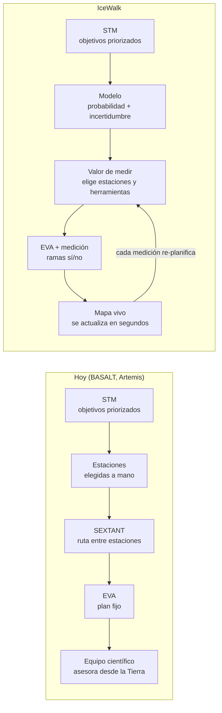
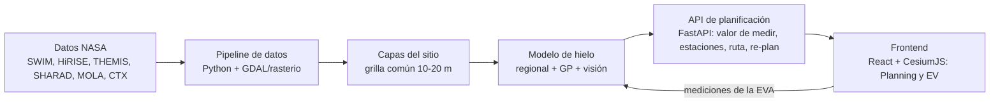

# PRD — Planificador de EVA de prospección de agua en Marte

Oct 28, 2026  · NASA Space Apps Challenge 2026

> Copia en el repo del PRD vivo (claude.ai). Fuente de verdad: el doc; esta copia se actualiza con un PR cuando cambia.

## Resumen

**Una herramienta que le dice al astronauta a dónde caminar para confirmar si hay hielo en Marte, y re-planifica la caminata con cada medición.** Nombre provisorio: *IceWalk* (a definir).

- **Problema:** los mapas orbitales sugieren dónde puede haber hielo, pero nunca lo confirman. La primera tripulación va a tener que salir a medir en el terreno, con tiempo, oxígeno y distancia limitados.
- **Solución:** sobre una zona hiperlocal, combinamos datos de varias misiones de NASA en un mapa de *evidencia de hielo* y otro de *incertidumbre*. Con eso elegimos las paradas donde medir aporta más información y calculamos la ruta caminable y segura que las conecta. Cada medición actualiza el mapa y la ruta.
- **Por qué no es lo obvio:** la mayoría de los equipos va a hacer un mapa con capas y una ruta A→B. Nosotros resolvemos una decisión real: *dónde medir para saber*. El mapa aprende con cada caminata. Y la misión se define como en NASA, con una matriz de trazabilidad científica, no con tipos fijos.
- **Frase de cierre del pitch:** «Cada caminata mejora el mapa para la siguiente.»

## Diferencial

**NASA ya planifica rutas. Nosotros planificamos qué aprender.** Respetamos el flujo actual (STM, estaciones, ruta, EVA) y cambiamos dos pasos: cómo se eligen las estaciones y cómo se adapta el plan durante la EVA.



- **Estaciones elegidas por los datos.** Hoy las eligen científicos a mano y es gran parte del trabajo de planificación ([BASALT](https://www.ncbi.nlm.nih.gov/pmc/articles/PMC6442241/)); SEXTANT solo optimiza la ruta entre ellas ([NTRS](https://ntrs.nasa.gov/api/citations/20190001439/downloads/20190001439.pdf)). Nosotros calculamos dónde medir enseña más, con la incertidumbre cuantificada.
- **Feedback constante: mapa vivo.** Cada medición actualiza el mapa y el plan en segundos, en lugar de un plan fijo corregido por asesoramiento humano.
- **Autonomía real en Marte.** En la Luna, la Tierra está a segundos; en Marte, a minutos. Las ramas precalculadas y la re-planificación local le dan a la tripulación lo que en Artemis aporta el equipo científico en la Tierra.
- **La incertidumbre como métrica.** Cada EVA y la campaña completa se miden por cuánto redujeron la incertidumbre del sitio.
- **Herramientas recomendadas con justificación.** Del catálogo certificado, como en Artemis; decide el equipo científico.

**Dónde ponemos el esfuerzo.** Los datos ya vienen procesados (SWIM publica cada fuente como capa lista), así que lo que el jurado va a valorar es qué hacemos con ellos: el modelo, la selección de estaciones, la re-planificación y la demo. Mínimo esfuerzo en procesar datos; máximo en lo que nos diferencia.

## Problema y usuario

El usuario principal es un astronauta en una caminata (EVA) de prospección; el secundario es quien la planifica desde el hábitat.

| Usuario | Contexto | Qué necesita |
| --- | --- | --- |
| Astronauta en EVA (EV1/EV2, en pareja) | Traje presurizado, guantes, visibilidad limitada, cansancio, tiempo de EVA acotado | Saber a dónde ir ahora, si el camino es seguro y cuánto margen tiene para volver. Pocas palabras, todo a simple vista |
| Planificador en el hábitat | Arma la EVA del día con la tripulación; la Tierra responde con minutos de demora | Elegir objetivos, comparar rutas, ver qué se gana con cada parada y re-planificar rápido |
| Científico (Tierra) | Recibe resultados después | Que las mediciones queden geolocalizadas y mejoren el mapa |

**Restricciones reales que usamos como requisitos:**

- Pendiente máxima caminable con traje: 20°, valor lunar; usarlo en Marte es un supuesto ([NASA xEVA](https://ntrs.nasa.gov/api/citations/20210000827/downloads/Exporation%20EVA%20Testing%20and%20Analogs%2020210000827.pdf)).
- Regreso a pie: los \~10 km son para falla de un rover. Caminando, el alcance de referencia es \~2 km del refugio ([xEVA Con Ops](https://ntrs.nasa.gov/api/citations/20205008200/downloads/EVA-EXP-0042%20xEVA%20System%20Con%20Ops%20Rev%20B%20Final%20dtd%2010192020_REF%20DOC.pdf)), también lunar: NASA deja los rangos de Marte como trabajo pendiente. Criterio heredado de Apollo ([Walkback Test](https://bvbvf1.bib-bvb.de/vufind/PrimoRecord/cdi_jstor_primary_44719456/Details)).
- Hielo cercano a la superficie (\~1 m) se confirma en el suelo con espectrómetro de neutrones; el más profundo, con radar ([National Academies](https://www.nationalacademies.org/read/28594/chapter/5)).

**Insight:** el cuello de botella no es encontrar zonas con posible hielo (SWIM ya lo hace a escala global). Es decidir, con recursos limitados, dónde medir para pasar de «probable» a «confirmado».

**¿Cómo podríamos...** ayudar a una tripulación a confirmar la mayor cantidad de hielo útil por caminata, sin salir nunca de su margen de seguridad?

**Validación con usuarios (design thinking):** antes del 3 nov, conseguir al menos una charla de 20 min con alguien del área (geólogo planetario, ingeniero aeroespacial o mentor de Space Apps) y testear el HUD con 3-5 personas usando guantes gruesos.

## Alineación con el challenge

Cubrimos todo lo que pide el enunciado y le sumamos un objetivo científico concreto: el agua, una de las dos prioridades científicas principales para las primeras misiones humanas ([National Academies, 2025](https://cosparhq.cnes.fr/assets/uploads/2026/03/COSPAR-PPP-Briefing-Slides-Jan-2026.pdf)).

| Lo que pide el challenge | Cómo lo cumplimos |
| --- | --- |
| Mapa o herramienta para un astronauta en superficie | Modo planificación (tablet/hábitat) + modo HUD para la EVA |
| Ubicación hiperlocal, no regional | Zona de \~10 × 10 km alrededor del hábitat, a resolución de metros |
| Objetivo científico y ubicación elegidos | Confirmar hielo cercano a la superficie en latitudes medias |
| Al menos 3 tipos de datos combinados | Topografía, térmico, radar, neutrones/hidrógeno, imagen óptica, radiación |
| Seguridad del astronauta | Pendiente ≤ 20°, margen de regreso, alertas de radiación y polvo |
| Ruta que evita obstáculos considerando la movilidad del traje | Ruta de menor costo con paradas óptimas |
| Imágenes en primera persona | Vista 3D a nivel del suelo de cada parada (terreno HiRISE) |
| Rovers o trabajo en pareja (opcional) | Roles EV1/EV2 en las paradas; rover como extra |
| Producto interactivo o sistema que genera mapas | Pipeline replicable a otro sitio con datos HiRISE |

## Alineación con la operación de NASA

**Principio de diseño: cada pieza del producto corresponde a una práctica documentada de NASA, con su fuente. No inventamos reglas.** Si una decisión no tiene respaldo, se marca como supuesto y se valida con un experto.

| Práctica de NASA | Cómo la aplicamos | Fuente |
| --- | --- | --- |
| Objetivos definidos en una matriz de trazabilidad científica (STM), ordenados por prioridad | Entrada del planificador; sin tipos de misión fijos | [BASALT](https://www.ncbi.nlm.nih.gov/pmc/articles/PMC6442241/), [Artemis III](https://ntrs.nasa.gov/api/citations/20250002094/downloads/a3gt_updates_lpsc2025_final.pdf) |
| Planificación estratégica (antes de la misión) y táctica (durante) | Nuestras fases «antes» y «durante», con esos nombres | [BASALT](https://pmc.ncbi.nlm.nih.gov/articles/PMC6442304) |
| Estaciones priorizadas con actividades de la tripulación, tiempos e hipótesis | Ficha de cada estación del plan | [JETT3](https://ntrs.nasa.gov/api/citations/20230003806/downloads/Young.theintegration.poster.pdf) |
| Equipo científico de apoyo (Science Evaluation Room) que asesora al control de vuelo vía un Science Officer | Vistas separadas: EV (traje), IV (hábitat) y ciencia | [LPSC 2024](https://ntrs.nasa.gov/api/citations/20240000165/downloads/Broddrick_LPSC_24_abstract.pdf) |
| Herramientas de planificación, línea de tiempo y optimización de rutas (Minerva: xGDS, Playbook, SEXTANT) | Mismos productos de salida: mapa de traverse, timeline, ruta; sumamos la selección de estaciones | [NTRS](https://ntrs.nasa.gov/api/citations/20190001439/downloads/20190001439.pdf) |
| Operación con demora y límites de transmisión tipo Marte | Decisiones en el lugar y ramas precalculadas | [NTRS](https://ntrs.nasa.gov/api/citations/20190001439/downloads/20190001439.pdf) |
| Límites de consumibles y regreso caminando (walkback) con reserva | Reserva de 20 % y margen de regreso en cada punto | [Apollo 15](https://www.nasa.gov/wp-content/uploads/static/history/alsj/19790073512_1979073512.pdf) |
| Protección planetaria: limita objetivos, sobre todo la búsqueda de vida con humanos | Capa de zonas sensibles y protocolos de muestreo en el plan | [National Academies](https://content.presspage.com/uploads/1906/7f980fe7-d338-41cc-b892-302826aba5a9/2a.wagner.pdf) |
| Datos en archivos y formatos estándar de misiones (PDS, DTM de HiRISE) | Pipeline sobre esos productos, sin reprocesar | [HiRISE](https://hirise.lpl.arizona.edu/dtm/ESP_073578_2155) |

**Interfaz en inglés y con terminología NASA:** EV1/EV2, IV, station, traverse, egress/ingress, walkback, STM.

**Validación:** antes del 6 nov, revisar este mapeo con un experto (mentor de Space Apps, geólogo planetario o ingeniero aeroespacial) y corregir lo que no corresponda.

## Funcionalidades

El MVP es el ciclo completo en un sitio: STM → mapas → estaciones → plan → medición → re-planificación. Todo lo demás se suma solo si el ciclo ya anda.

| # | Funcionalidad | Prioridad | Qué ve el usuario |
| --- | --- | --- | --- |
| 1 | Globo de Marte + zoom al sitio | MVP | Globo 3D con zonas de hielo (SWIM) y vuelo hasta el sitio |
| 2 | Capas activables desde el registro | MVP | Topografía, térmico, radar, imagen; leyenda y fuente de cada capa |
| 3 | Editor de STM | MVP | Objetivos ordenados por prioridad, cada uno con su requisito de medición; plantillas editables |
| 4 | Mapas de probabilidad e incertidumbre | MVP | Probabilidad de hielo a ≤ 1 m y su incertidumbre por celda; unidades de terreno y anomalías |
| 5 | Transitabilidad | MVP | Zonas prohibidas (pendiente > 20°, bloques, cráter) y costo de caminar |
| 6 | Plan de EVA | MVP | Estaciones con ficha (prioridad, tareas EV1/EV2, herramienta, tiempo, hipótesis), ruta, timeline con restricciones, equipo y masa, margen de regreso, información esperada |
| 7 | Ramas sí/no | MVP | Variantes del plan precalculadas para las primeras estaciones |
| 8 | Vista EV sobre el terreno 3D en primera persona | MVP | Próxima estación, rumbo y distancia, margen, consumibles, alertas, checklist contextual, cargar medición |
| 9 | Re-planificación en vivo | MVP | La medición actualiza mapas y plan en segundos |
| 10 | Antes/después | MVP | Cuánto bajó la incertidumbre del sitio con la EVA |
| 11 | Protección planetaria | Alta | Zonas sensibles y protocolo de muestreo en el plan |
| 12 | Ventana de EVA | MVP | Por estación y hora: temperatura, viento, polvo, luz y clima espacial (DONKI), con niveles advisory, caution y warning |
| 13 | Radar mientras se camina | Media | La ruta recolecta información, no solo las estaciones |
| 14 | Vista Science | Baja | Mapa de incertidumbre, registro de mediciones, aprobar el plan |
| 15 | Segundo sitio (Erebus Montes) | Baja | Mismo sistema, otro lugar: prueba que es general |

## Interfaz (UX/UI)

**Tres vistas para usuarios técnicos, cada una basada en una herramienta real de NASA.** No diseñamos para un usuario común: no se simplifica la información, se simplifica solo lo que hoy es engorroso de operar. Interfaz en inglés y con terminología NASA.

### Qué usa NASA hoy

| Herramienta | Qué aprendemos | Fuente |
| --- | --- | --- |
| Checklist de papel en la muñeca (\~50 páginas) y módulo de display en el pecho | Es lo que hay hoy; los intentos electrónicos sufrieron reflejos, poco contraste y estorbaban el área de trabajo | [arXiv](https://arxiv.org/pdf/2402.15692), [NTRS](https://ntrs.nasa.gov/api/citations/19940019719/downloads/19940019719.pdf) |
| Mapas de traverse en papel (Apollo) | Luz extrema: sombras negras y sol enceguecedor | [arXiv](https://arxiv.org/pdf/2402.15692) |
| Joint AR (display montado en el traje) | Nada montado en la cabeza dentro del traje; modular para cualquier traje | [NTRS](https://ntrs.nasa.gov/api/citations/20230010234/downloads/Trades_ICES_2023_07_updated_software_name.pdf) |
| Informática de traje (Collins IT IS) | Estado del traje y consumibles, ubicación, terreno, rumbo, biometría, procedimientos, notas; independiente de la Tierra | [ICES 2021](https://ttu-ir.tdl.org/items/32a42436-1fd3-4308-9ef6-4ab2b76a26a7) |
| NASA SUITS | Minimapa 2D; navegación que se adapta cuando cambian los destinos; operable con guantes | [NASA](https://nasa.gov/wp-content/uploads/2023/09/fy24-suits-mission-description.pdf), [TAMU](https://astrocenter.tamu.edu/stem-outreach/nasa-suits/) |
| Playbook (timeline de tripulación) | La herramienta calcula y muestra las restricciones del plan; el usuario necesita entender el plan, no solo abstracciones | [SpaceCHI](https://hsi.arc.nasa.gov/publications/Zheng_etal_2023_SpaceCHI.pdf), [NTRS](https://ntrs.nasa.gov/api/citations/20230008619/downloads/Spacechi2023v5.pdf) |
| Estándares de interfaces de tripulación | Consistencia en apariencia y operación; color con moderación, para alertas y con significados estándar | [NASA-STD-3001](https://www.nasa.gov/reference/10-0-crew-interfaces-vol-2), [NTRS](https://ntrs.nasa.gov/api/citations/20240003566/downloads/CLD%20HSI%20Workshop%20Crew%20Interfaces.pdf) |

### Las tres vistas

| Vista | Usuario y dispositivo | Basada en | Contenido |
| --- | --- | --- | --- |
| Planning | IV y ciencia, en el hábitat; laptop o tablet | xGDS + SEXTANT + Playbook | Mapa con capas, editor de STM, fichas de estación, timeline con restricciones calculadas y marcadas, ramas, comparación de planes. Densa y técnica |
| EV | Astronauta en EVA; display del traje (simulado en la demo) | Cuff checklist + informática de traje + SUITS | Próxima estación, rumbo y distancia, margen de regreso, consumibles, alertas por nivel, minimapa 2D, procedimiento de la estación actual. Alto contraste, controles grandes, guante y voz |
| Science | Equipo científico, con demora de comunicación | Mission Log de Playbook + backroom de Artemis | Mapa de incertidumbre, registro de mediciones, aprobar o modificar el plan, mensajes asincrónicos |

**Alineación y prioridades.** El challenge pide una herramienta para **planificar y llevar a cabo** una Marswalk y sugiere formatos como pantalla en el hábitat, tablet o HUD en el visor, con imágenes en primera persona. El núcleo evaluado es el mapa con capas integradas; la interfaz del traje es un formato de entrega, no el producto (eso es terreno de NASA SUITS). Prioridades: **Planning = MVP** (lo más trabajado), **EV = MVP acotado** (una pantalla simulada sobre la vista 3D en primera persona: próxima estación, margen, alertas, cargar medición), **Science = extra** (se menciona en el pitch; se construye si sobra tiempo).

**Alcance: solo software.** La vista EV no depende del dispositivo: definimos qué ve el astronauta, en qué orden y cómo interactúa; el hardware de cada traje decide la pantalla, como en el enfoque modular de NASA ([Joint AR](https://ntrs.nasa.gov/api/citations/20230010234/downloads/Trades_ICES_2023_07_updated_software_name.pdf)). Aplicable hoy en **tablet**, formato que el challenge menciona y que ya se usa en misiones análogas con herramientas web como Playbook ([NTRS](https://ntrs.nasa.gov/api/citations/20170011315/downloads/20170011315.pdf)). El HUD se muestra simulado sobre la vista 3D como integración futura. Frase de pitch: «Software listo para tablet hoy, diseñado para integrarse a los displays de traje que NASA está desarrollando».

### Dónde simplificamos (porque hoy es complejo)

- **Checklist de \~50 páginas → checklist contextual:** el EV ve solo los pasos de la estación y la herramienta actual.
- **Registrar una medición:** un toque o un comando de voz («ice yes, 30 centimeters»), sin formularios.
- **Restricciones:** el sistema las calcula y marca las violaciones, como Playbook; nadie suma minutos de oxígeno a mano.

### Reglas de diseño

- Números reales siempre visibles (consumibles, márgenes, probabilidades, incertidumbre): son usuarios técnicos.
- Color solo para estado y alertas, con significados estándar; el resto en escala neutra.
- Alertas en tres niveles: advisory, caution, warning.
- Mismos componentes y posiciones en las tres vistas (consistencia).
- Vista EV legible con luz extrema: alto contraste y tipografía grande.

**A validar:** test de la vista EV con guantes gruesos y luz fuerte (3-5 personas) y revisión de las tres vistas con el experto.

## Datos NASA y capas

El desafío técnico central es que los datos vienen a escalas muy distintas: el hidrógeno se mide en cientos de km y las rocas en metros. El modelo combina capas gruesas como contexto y capas finas como detalle. Resoluciones aproximadas, a verificar al bajar cada dataset.

| Capa | Fuente | Qué aporta | Resolución aprox. | Uso |
| --- | --- | --- | --- | --- |
| Consistencia de hielo | [SWIM](https://science.nasa.gov/?p=320330) (MRO, Odyssey, MGS) | Prior regional de hielo; ya integra radar, térmico y neutrones | km | Evidencia (prior) |
| Cráteres que expusieron hielo | Catálogo de impactos con hielo (HiRISE) | Hielo confirmado: verdad de terreno | puntos | Validación + positivos |
| Hidrógeno / agua equivalente | Mars Odyssey (neutrones/GRS) | Hidrógeno en el primer metro | cientos de km | Evidencia (contexto) |
| Radar subsuperficial | SHARAD (MRO) | Capas de hielo en profundidad | km | Evidencia + profundidad |
| Inercia térmica | THEMIS (Odyssey) | Suelo con hielo se calienta y enfría distinto | \~100 m | Evidencia (fina) |
| Imagen de alta resolución | HiRISE (MRO) | Terreno poligonal, rocas, textura | 25-50 cm | IA de visión + POV |
| Modelo de elevación fino | HiRISE DTM | Pendiente, rugosidad, 3D | \~1-2 m | Transitabilidad + vista 3D |
| Imagen de contexto | CTX (MRO) | Mosaico del sitio completo | \~6 m | Mapa base |
| Topografía global | MOLA (MGS) | Globo 3D y elevación general | \~460 m | Globo |
| Radiación | RAD (Curiosity) | Dosis en superficie de referencia | sitio de Curiosity | Alertas (supuesto) |

**Regla del sitio:** elegimos una zona en latitudes medias del norte con (1) hielo confirmado por cráteres cercanos, (2) cobertura HiRISE DTM y (3) terreno variado para que la ruta sea interesante. Sitio de demostración: cráter S1094b en Amazonis Planitia (\~35°N), formado en 2021, con hielo expuesto a la latitud más baja observada. Plan B: Erebus Montes (Arcadia Planitia). El sistema es general; el sitio es el caso donde lo demostramos y validamos. Si sobra tiempo, cargar el plan B como segundo sitio prueba que funciona en cualquier lugar con datos. HiRISE DTM verificado (ver Contrato de grilla).

**Las capas son intercambiables.** La lista de arriba es la de hoy; el 13 nov salen los Resources oficiales y puede cambiar. Por eso nada del sistema depende de un dataset puntual:

- **Registro de capas en un archivo de configuración (YAML).** Cada capa declara: id, fuente, adaptador, rol (evidencia de hielo, costo de caminar o solo visual), unidades y peso inicial.
- **Un adaptador por fuente.** Convierte el dataset crudo a la grilla común y lo normaliza. Sumar un dataset = escribir un adaptador + una línea de configuración.
- **El modelo lee «N capas de evidencia», no capas con nombre.** Si cambia el conjunto, se re-entrena y re-valida con un comando.
- **La transitabilidad lee capas con rol «costo».** Un nuevo DTM o mapa de rocas entra sin tocar el planificador.
- **El frontend arma la lista de capas desde un manifiesto que entrega la API.** Una capa nueva aparece sola en la interfaz, con su leyenda y fuente.

Regla para el equipo: si una capa nueva obliga a cambiar código fuera de su adaptador, el diseño está mal y se corrige.

### Contrato de grilla

Todas las capas se alinean a una misma grilla, definida en un único `grid.json` que leen Datos, Modelo, Rutas y Frontend.

| Parámetro | Valor | Motivo |
| --- | --- | --- |
| Extensión | Caja de 6.56 × 11.63 km que contiene la huella del HiRISE DTM (rotada, \~5.4 km de ancho), con origen en el cráter | Es donde hay topografía a 1 m; afuera solo contexto (CTX/MOLA) |
| Celda base | 10 m | Transitabilidad, ruta y evidencia; A\* rápido sobre \~10⁵-10⁶ celdas |
| Detalle en cada celda | Pendiente máxima y rugosidad calculadas desde el DTM de 1 m | Un escalón corto no se pierde: más seguro que el promedio |
| Paradas candidatas | Subgrilla de 100 m | Re-planificación en segundos |
| Proyección | Equirectangular centrada en el sitio, metros, elevación sobre el areoide (como el DTM) | Misma que los productos HiRISE: sin re-proyectar el dato más pesado |
| Formato de análisis | GeoTIFF optimizado (COG), float32, valor nodata definido | Estándar, liviano, lectura parcial |
| Formato web | PNG + JSON con límites lat/lon y escala de colores | Lo consume Cesium directo |
| Remuestreo | Bilineal para continuas, vecino más cercano para categóricas; cada capa guarda su resolución original | El modelo sabe qué capas son «borrosas» |

**DTM del sitio verificado:** existe `DTEEC_073578_2155_073077_2155_A01`, a 1 m/píxel, con centro cerca de 35.09°N, 189.83°E (el cráter está en 35.1105°N, 189.8273°E, medido sobre el orto), equirectangular y atado a elevaciones MOLA ([HiRISE](https://hirise.lpl.arizona.edu/dtm/ESP_073578_2155)). Elevación entre −3962 y −3926 m: el terreno es casi plano fuera del cráter, así que la ruta la condicionan sobre todo el cráter y los bloques, no la pendiente. Antes de usarlo, revisar el relieve sombreado y el mapa de calidad (FOM) por artefactos conocidos de los DTM ([README](https://hirise.lpl.arizona.edu/PDS/EXTRAS/DTM/ESP/ORB_073500_073599/ESP_073578_2155_ESP_073077_2155/README_DTEEC_073578_2155_073077_2155_A01.TXT)).

### Lista de descarga (día 1)

Sitio: S1094b, 35.11°N, 189.83°E (−170.17° en longitud con signo). **Atajo clave:** SWIM ya publica, además del mapa combinado, un mapa de consistencia de hielo por cada fuente (neutrones, térmico, radar, geomorfología) en GeoTIFF. No bajamos los datos crudos de cada instrumento: usamos esas capas.

| Capa | Producto | Dónde | Formato / tamaño | Para qué |
| --- | --- | --- | --- | --- |
| Hielo regional (0-1 m, 1-5 m, >5 m) + capas por fuente | SWIM, productos globales (actualizados en 2025) | [swim.psi.edu](https://swim.psi.edu/SWIM4MIMProducts.php) | GeoTIFF, valores −1 a +1, sin dato = −30; píxel de 1/20° (\~3 km) | Prior y features del modelo regional |
| Topografía fina | HiRISE DTM `DTEEC_073578_2155_073077_2155_A01` | [HiRISE](https://hirise.lpl.arizona.edu/dtm/ESP_073578_2155) | IMG, 1 m, 306 MB | Pendiente, rugosidad, 3D |
| Ortoimagen para análisis | `ESP_073578_2155_RED_C_01_ORTHO` | mismo link | JP2, 1 m, 22 MB | Albedo, base del mapa |
| Ortoimagen para bloques | `ESP_073578_2155_RED_A_01_ORTHO` | mismo link | JP2, 25 cm, 235 MB | Detección de bloques y hielo expuesto |
| Serie temporal del cráter | HiRISE ESP\_073077, ESP\_076677, ESP\_083099 (\_2155) | [HiRISE](https://hirise.lpl.arizona.edu/ESP_076677_2155) | JP2 | Mostrar que el hielo expuesto se sublima |
| Contexto visual | Mosaico global CTX (Murray Lab), tile de 4°×4° que contiene el sitio | [Murray Lab](https://murray-lab.caltech.edu/CTX/) | GeoTIFF, 5 m | Mapa base alrededor del DTM |
| Inercia térmica | THEMIS, mosaico cuantitativo 100 m, cuadrante 30-60°N que contiene 189.8°E (verificar nombre exacto) | [USGS](https://astrogeology.usgs.gov/search/map/themis_thermal_inertia_mosaic_qualitative_30n120e_100_mpp) | GeoTIFF/ISIS, \~100 m | Feature local del modelo |
| Topografía global | MOLA-HRSC blend 200 m | [USGS](https://astrogeology.usgs.gov/search/map/mars_mgs_mola_mex_hrsc_blended_dem_global_200m) | GeoTIFF global, 11 GB: recortar con GDAL sin bajar todo | Globo y contexto |
| Cráteres nuevos con/sin hielo | Daubar et al. 2022 | [Zenodo](https://zenodo.org/record/6604912) | 196 kB | Etiquetas del modelo regional |
| Exposiciones de hielo | Dundas et al. 2021 | [USGS](https://www.usgs.gov/index.php/data/locations-and-properties-ice-exposing-scarps-and-new-impact-craters-mid-latitudes-mars) | Data release | Validación |

**Notas para Datos:**

- Bajar HiRISE en resolución C (1 m) para todo, y A (25 cm) solo para bloques.
- El MOLA-HRSC global pesa 11 GB: recortar la zona leyéndolo remoto con GDAL (`/vsicurl/`); si falla, usar un recorte más grande.
- Registrar en el registro de capas la fuente, licencia y cita de cada producto: las reglas exigen citar todo.

## Modelo y planificador

Son dos piezas: **el modelo dice qué sabemos** (probabilidad de hielo e incertidumbre en cada celda) y **el planificador decide qué hacer** con eso. Todo gira alrededor de una pregunta: ¿hay hielo en el primer metro bajo el suelo? Es lo que detecta un espectrómetro de neutrones desde la superficie y lo que se puede perforar a mano con traje.

El modelo responde esa pregunta con probabilidades en todo el mapa; el astronauta la responde con certeza solo donde mide; esa medición corrige el mapa alrededor.

### Tres fases

| Fase | Dónde corre | Entrada | Salida |
| --- | --- | --- | --- |
| Antes de la EVA | Hábitat | Capas, mediciones previas, objetivo de la misión, límites de seguridad | Mapas de probabilidad e incertidumbre; plan completo (paradas, ruta, herramientas, tripulación, duración) con ramas precalculadas «si da sí / si da no» |
| Durante la EVA | Tablet o HUD | Resultado de la medición (lectura de neutrones, profundidad del taladro), posición, tiempo y consumibles restantes | Mapa actualizado en milisegundos y una acción concreta: «Parada C, 420 m al noreste, medir 10 min» o «Volver» |
| Después | Hábitat | Todas las mediciones de la EVA | Mapa con menos incertidumbre: la próxima EVA arranca mejor |

### Componentes del modelo

| Componente | Tipo | Qué hace | Plan B |
| --- | --- | --- | --- |
| Unidades de terreno | No supervisado (clustering sobre todas las capas) | Divide el sitio en tipos de terreno sin etiquetas; el plan mide al menos una vez cada unidad | Unidades por umbrales simples |
| Anomalías | No supervisado | Marca zonas que no se parecen al resto en HiRISE (brillos, texturas): posible hielo expuesto o ciencia | Umbral de albedo |
| Prior regional | Supervisado (clasificador simple) | Probabilidad de hielo según latitud, elevación, inercia térmica, SWIM, hidrógeno y tamaño del cráter. Entrenado con el [catálogo de cráteres nuevos](https://pubs.usgs.gov/publication/70248034) que indica si cada impacto expuso hielo | Prior de SWIM |
| Campo local | Proceso gaussiano | Probabilidad e incertidumbre por celda de 10 m; combina lo anterior y cada medición. Alcance de \~100-300 m, porque el hielo varía en decenas a cientos de metros ([Dundas et al. 2021](https://usgs.gov/publications/widespread-exposures-extensive-clean-shallow-ice-mid-latitudes-mars)) | — |
| Bloques | Visión (detección) | Obstáculos y ancho de pasillo para la ruta | Detección por sombras |
| Formas del terreno | Visión | Polígonos y similares: indicio indirecto de hielo para el GP | Geomorfología de SWIM |

Un cráter que no expuso hielo no prueba que no haya: puede ser poco profundo. Por eso el tamaño del cráter entra como variable. Descartamos aprendizaje por refuerzo para la ruta: no hay datos para entrenarlo y un planificador clásico es más confiable y explicable.

### Planificador

**Valor de medir.** Para cada parada candidata, cuánto bajaría la incertidumbre del mapa si midiéramos ahí, ponderado por lo útil que sería ese hielo:

```latex
VoI(x) = w(x) \cdot \sum_{c \in \text{zona}} \left[ \sigma^2_{\text{antes}}(c) - \sigma^2_{\text{después}}(c \mid x) \right]
```

w(x) pondera el propósito (recurso o ciencia) y la probabilidad de hielo. Con un proceso gaussiano, la reducción de incertidumbre se calcula antes de ir, así que el plan completo sale de una.

**Factibilidad, con el método de NASA.** Como el modelo de traverse de la Mars Campaign Office ([ICES-2025-129](https://ntrs.nasa.gov/api/citations/20250001829/downloads/ICES%202025%20TraverseModel.pdf?attachment=true)): una **capa de exclusión** (pendiente > 20° y celdas sin pasillo), un **costo metabólico** (pendiente, velocidad, peso, carga y terreno) y límites de **consumibles, duración y regreso a un refugio**. No encontramos una fuente que fije qué tamaño de roca sortea un astronauta: una celda se prohíbe solo si no queda un pasillo que la cruce, y el ancho mínimo es un supuesto declarado. En S1094b el terreno es casi plano: mandan el cráter y los bloques.

**Entrada: la matriz de trazabilidad científica (STM) de la misión.** No hay tipos de misión fijos. Como en la práctica de NASA ([BASALT](https://www.ncbi.nlm.nih.gov/pmc/articles/PMC6442241/), [JETT3/Artemis](https://ntrs.nasa.gov/api/citations/20230003806/downloads/Young.theintegration.poster.pdf)), el usuario carga sus objetivos **ordenados por prioridad** ([Artemis III](https://ntrs.nasa.gov/api/citations/20250002094/downloads/a3gt_updates_lpsc2025_final.pdf)) y, para cada uno, su requisito de medición: qué variable, a qué profundidad, con qué densidad de muestreo y si hace falta traer muestra. Plantillas opcionales solo como punto de partida editable.

**Catálogo de herramientas** (configurable; capacidades de instrumentos reales de rovers, tiempos y versión portátil son supuestos). Es la práctica de NASA: para Artemis se arma un catálogo de herramientas certificadas del que el equipo científico elige para cada misión ([NTRS](https://ntrs.nasa.gov/api/citations/20210000242/downloads/Developing%20Geology%20Sampling%20Tools_Lunar%20Surface%20Science%20Workshop_FINAL_2021.pdf)), dentro de límites de tiempo, distancia y masa ([NASA](https://science.nasa.gov/wp-content/uploads/2024/08/8-artemis-science-planning-samples.pdf)). El planificador recomienda con justificación y respeta un presupuesto de masa; decide el equipo científico.

| Herramienta | Qué detecta | Profundidad | Uso |
| --- | --- | --- | --- |
| Espectrómetro de neutrones (tipo DAN, Curiosity) | Hidrógeno (agua) | \~60 cm ([NASA](https://science.nasa.gov/photojournal/russian-hydrogen-checking-instrument-on-curiosity-fires-2-millionth-pulse/)) | Parada corta, \~10-15 min |
| Radar de penetración (tipo RIMFAX, Perseverance) | Capas e hielo enterrado | Hasta \~10 m, resolución 15-30 cm ([RIMFAX](https://en.wikipedia.org/wiki/RIMFAX)) | Mide mientras se camina |
| Taladro de testigos | Confirma, mide profundidad, extrae muestra | \~1 m | Parada larga, \~30-45 min, 2 personas |
| Cámara/espectrómetro de mano | Superficie, bloques de hielo expuesto | Superficie | \~5 min |

**Del objetivo al plan.** El planificador cruza cada requisito de medición con las capacidades del catálogo y elige qué medir y con qué en cada parada. Agrega paradas una a una, eligiendo cada vez la que más información aporta por minuto extra, hasta llegar al techo; después ordena la ruta para caminar menos. Con el radar, la ruta misma recolecta información, así que un desvío por una zona dudosa puede valer la pena. Para las primeras paradas precalcula las ramas «sí/no».

**Tripulación y duración.** EVA en pareja (EV1/EV2) con tareas asignadas por parada. Duración = egreso + caminata + mediciones + ingreso + reserva de 20 % para volver caminando, como en Apollo ([NASA](https://www.nasa.gov/wp-content/uploads/static/history/alsj/19790073512_1979073512.pdf)). Techo por defecto: 8 h, la autonomía de los trajes AxEMU de Artemis ([Flying](https://www.flyingmag.com/axiom-completes-initial-crew-testing-of-next-generation-spacesuits/)). Lo único fijo son los límites de seguridad (pendiente, autonomía, margen de regreso), todos configurables.

**Salida.** Ruta con paradas y horarios, tareas de EV1 y EV2 en cada parada, lista de equipo con masa total, duración y margen de regreso en cada punto, información esperada de la EVA y ramas de contingencia.

**Dónde nos ubicamos.** En BASALT, NASA usó el software Minerva, cuya herramienta SEXTANT optimiza la ruta entre estaciones ya elegidas; elegir las estaciones fue trabajo manual del equipo científico ([NTRS](https://ntrs.nasa.gov/api/citations/20190001439/downloads/20190001439.pdf)). Trabajos recientes proponen optimizar EVAs para maximizar ciencia dentro de límites de tiempo y distancia ([LPSC 2024](https://ntrs.nasa.gov/api/citations/20240000165/downloads/Broddrick_LPSC_24_abstract.pdf)). Nuestro paso extra: elegir las estaciones a partir de los datos y la incertidumbre.

**Re-planificación.** Cada medición entra al proceso gaussiano como dato observado; se recalculan mapas, valor y ruta restante con el tiempo y los consumibles que quedan.

**Base práctica:** es el mismo razonamiento que la exploración minera en la Tierra, donde con pocas perforaciones caras se modela el yacimiento con geoestadística y se decide dónde perforar después.

### Cómo demostramos que anda

**Modelo regional**

- Validación cruzada por bloques espaciales (se deja afuera una región entera, no puntos sueltos), para que el modelo no «haga trampa» con vecinos cercanos.
- Métricas: área bajo la curva ROC, puntaje de Brier y diagrama de calibración (cuando dice 70 %, ¿acierta cerca del 70 %?).
- Prueba clave: dejar S1094b afuera y ver si el modelo le da probabilidad alta.
- Comparación contra la línea base: usar solo el mapa combinado de SWIM.

**Modelo local y planificador (Martes simulados)**

- Generar \~500 mapas de hielo plausibles del sitio: campos aleatorios con la media del modelo regional y alcances de 100, 200 y 300 m, convertidos a hielo sí/no.
- Simular mediciones con un margen de error del instrumento (supuesto explícito).
- Comparar cuatro estrategias con el mismo tiempo, distancia y límites de seguridad: la nuestra (valor de medir), ir al punto más probable, puntos al azar alcanzables y una grilla regular.
- Métricas: área del sitio clasificada con ≥ 90 % de confianza, incertidumbre reducida por km caminado y cantidad de EVAs para llegar a una meta.
- Reportar promedio con intervalo de confianza y cómo cambia según el alcance supuesto. Ese gráfico va al pitch; el número sale de la simulación, no se promete antes.

## Seguridad y entorno

### Radiación y clima espacial

- **Dosis de base.** El detector RAD de Curiosity midió en superficie un promedio de 0.67 mSv por día de rayos cósmicos galácticos ([SwRI/Science](https://phys.org/news/2013-12-scientists-publish-surface-mars.amp)). La atmósfera funciona como blindaje: a más presión, menos dosis, con variaciones diarias de 3-5 % ([NASA/JPL](https://phys.org/news/2012-11-humans-mars.pdf)). S1094b está a unos −3.9 km de elevación, parecido a Gale (\~−4.4 km): blindaje similar ([EGU](https://meetingorganizer.copernicus.org/EGU2013/EGU2013-6068-5.pdf)).
- **El riesgo real son las tormentas solares.** El flujo de partículas solares puede variar cinco órdenes de magnitud en un día ([EGU](https://meetingorganizer.copernicus.org/EGU2013/EGU2013-6068-5.pdf)), y una erupción solar grande podría afectar agudamente a un astronauta con traje ([Universe Today](https://universetoday.com/98509/can-humans-live-on-mars/amp)).
- **Fuente de datos:** DONKI, la base de eventos de clima espacial de NASA (CCMC, Goddard), con API pública de erupciones, eyecciones de masa coronal y eventos de partículas ([NASA](https://www.techbriefs.com/component/content/article/38489-gsc-tops-223)). API actual: `ccmc.gsfc.nasa.gov/DONKI-API/get/` (verificado).
- **En el plan:** dosis estimada de la EVA = tasa de base × duración, mostrada en el plan. Un aviso de evento de partículas dispara la rama «volver al hábitat», y el margen de regreso garantiza que se pueda en cualquier punto. En la demo se reproduce un evento histórico de DONKI como escenario simulado.

### Polvo

- Fuente: los reportes semanales de clima de MARCI (MRO), que siguen tormentas de polvo en todo el planeta, incluidas las que cruzan Arcadia ([NASA](https://science.nasa.gov/resource/martian-weather-report/)).
- En el plan: nivel de polvo como aviso operativo (visibilidad y navegación), cargado por la tripulación o el equipo científico; no es un dato en tiempo real.

### Ventana de EVA

El clima cambia poco dentro del sitio, así que no va como capa del mapa: define **cuándo salir**. El plan muestra, por estación y hora, temperatura, viento, polvo, luz y clima espacial, con niveles advisory, caution y warning. El viento importa por el polvo que levanta más que por su empuje. Fuente candidata: [Mars Climate Database](https://trac.lmd.jussieu.fr/Planeto/export/971/trunk/UTIL/PYTHON/mcd/proto/index5.html) (confirmar acceso y licencia). No encontramos umbrales oficiales para una EVA en Marte: todo límite va como supuesto.

### Protección planetaria

- **Regla:** NASA sigue las guías de COSPAR ([National Academies](https://nap.nationalacademies.org/read/11937/chapter/9)). Una «región especial» es un lugar con temperaturas sobre −25 °C unas horas al año y actividad de agua sobre 0.5, donde podrían replicarse microorganismos terrestres ([COSPAR](https://repository.lsu.edu/geo_pubs/632)). Como ejemplo, Perseverance tuvo prohibido aterrizar donde pudiera haber hielo a menos de 5 m, por el calor de su generador ([jatan.space](https://jatan.space/special-regions-on-mars/)).
- **La tensión es real y la mostramos:** nuestro objetivo (hielo cerca de la superficie) coincide con zonas sensibles. Las reglas para misiones humanas todavía se están definiendo, así que aplicamos un enfoque conservador.
- **En el plan:** estaciones con hielo probable y actividades que generan calor (perforar) se marcan como sensibles, requieren aprobación del equipo científico y llevan protocolo: herramientas y contenedores limpios, registro de contaminación y límite de profundidad.

## Arquitectura y tecnologías

Todo lo pesado (datos, visión) se precalcula una vez; en vivo solo corren el modelo de hielo actualizado y el planificador, para que la demo responda en segundos.



El frontend lee las capas directamente como teselas y le pide a la API las paradas y la ruta; cada medición cargada en la EVA vuelve al modelo.

| Parte | Tecnología | Por qué |
| --- | --- | --- |
| Datos | Python, GDAL, rasterio, numpy | Estándar para rasters planetarios; maneja proyecciones de Marte |
| Prior regional | scikit-learn (clasificador simple) | Pocos datos etiquetados; explicable |
| Unidades de terreno y anomalías | scikit-learn (clustering y detección de anomalías) | No necesitan etiquetas |
| Campo local | Proceso gaussiano (numpy o GPyTorch) | Probabilidad e incertidumbre; se actualiza en milisegundos |
| Visión | PyTorch (detector de bloques) o detección por sombras | Obstáculos para la ruta |
| Planificador | Python: selección codiciosa + A\* (numpy o scikit-image) | Rápido y explicable |
| API | FastAPI | Simple, rápida, documenta sola los endpoints |
| Frontend | React + Vite + CesiumJS | Globo, terreno 3D y vista en primera persona (Marte soportado desde 1.133) |
| Diseño | Figma | Tres vistas y componentes compartidos |
| Deploy | Vercel (front) + Render o Hugging Face Spaces (API) | Gratis y con link público para el jurado |
| Código | GitHub público, licencia Apache 2.0, carpeta por rol | Las reglas piden código abierto; evita pisarse |

## Especificación técnica

Todo lo definido acá puede ajustarse, pero cualquier cambio a un contrato se acuerda en el grupo y se hace en un solo PR.

### Repositorio

Monorepo público en GitHub, licencia Apache 2.0. Front y API se despliegan por separado desde sus subcarpetas.

```
icewalk/
├── contracts/   # grid.json, esquemas JSON (STM, catálogo, medición, API)
├── data/        # scripts de descarga y procesamiento; registro de capas (layers.yaml)
├── model/       # prior regional, unidades, anomalías, GP local, bloques, validación
├── planner/     # STM, valor de medir, transitabilidad, rutas, ramas, API (FastAPI)
├── web/         # React + Cesium: vistas Planning y EV
├── design/      # exports de Figma y assets
├── docs/        # fuentes citadas, licencias, decisiones
└── README.md
```

**Datos fuera de Git.** En el repo van los scripts que bajan y procesan; los productos procesados (GeoTIFF recortados, PNG, teselas) se publican como assets de GitHub Releases y se bajan con un script. `.gitignore` excluye `data/raw/` y `data/processed/`.

### Stack

| Parte | Herramientas |
| --- | --- |
| Python (datos, modelo, planificador) | Python 3.12, entornos con uv, ruff (lint), pytest |
| Datos | GDAL, rasterio, numpy, pyproj |
| Modelo | scikit-learn, numpy/scipy (GP), PyTorch solo si se entrena el detector de bloques |
| Planificador y API | FastAPI, pydantic (esquemas), scikit-image o A\* propio |
| Web | React + Vite + TypeScript, CesiumJS, Zustand (estado), Tailwind CSS |
| Calidad | GitHub Actions: lint y tests en cada PR |
| Deploy | Vercel (`web/`), Render o Hugging Face Spaces (`planner/`) |

**Terreno 3D (verificado):** CesiumJS 1.133+ trae `Ellipsoid.MARS` y existe Cesium Mars, globo 3D de Marte en Cesium ion con terreno global de 200 m ([Cesium](https://cesium.com/platform/cesium-ion/content/cesium-mars/)). Lo usamos para el globo; para el sitio, nuestro DTM de 1 m. Requiere cuenta gratuita de Cesium ion. Plan B para el sitio: malla de altura con three.js.

**Clima espacial (verificado):** la API de DONKI se mudó el 30/9/2026 a `ccmc.gsfc.nasa.gov/DONKI-API/get/` y no pide key; la de api.nasa.gov dejó de devolver datos.

**Esqueleto del repo armado (29 oct):** contratos con esquemas y ejemplos validados, registro de 11 capas con links, script de descarga, API FastAPI con planificador de ejemplo que respeta los contratos (plan y re-plan tras medición negativa), mocks JSON para la web, CI, fuentes y decisiones. 6 tests pasando.

### Contratos (resumen)

**`grid.json`**: proyección (equirectangular centrada en el cráter, 35.1105°N, 189.8273°E, con el radio de los productos HiRISE), origen, tamaño de celda (10 m), filas, columnas y tamaño de la subgrilla de estaciones (100 m).

**STM** (entrada del planificador):

```json
{
  "mission_id": "s1094b-eva1",
  "constraints": { "eva_max_h": 8, "reserve": 0.2, "max_slope_deg": 20, "crew": 2, "mass_budget_kg": null },
  "objectives": [
    { "rank": 1, "title": "Lateral extent of shallow ice", "hypothesis": "...",
      "measurement": { "variable": "ice_presence", "depth_max_m": 1, "coverage": "all_terrain_units", "sample_return": false } }
  ]
}
```

**Herramienta del catálogo:**

```json
{ "id": "neutron_spectrometer", "detects": ["hydrogen"], "depth_m": 0.6, "time_min": 12,
  "mass_kg": null, "crew": 1, "mode": "stop", "generates_heat": false, "source": "..." }
```

`mode` es `stop` (en estación) o `traverse` (mientras se camina, como el radar). Los valores sin fuente se marcan como supuestos.

**Medición:**

```json
{ "station_id": "S3", "tool": "neutron_spectrometer", "result": "ice", "depth_m": 0.3,
  "position": [x, y], "timestamp": "..." }
```

### API

| Endpoint | Qué hace |
| --- | --- |
| `GET /layers` | Manifiesto de capas registradas (id, rol, leyenda, fuente, URL) |
| `GET /catalog/tools` | Catálogo de herramientas |
| `GET /maps/{probability, uncertainty, value}` | Raster actual de cada mapa |
| `POST /plan` | Recibe STM + mediciones previas; devuelve estaciones, ruta (GeoJSON), timeline, ramas, equipo, dosis e información esperada |
| `POST /replan` | Recibe la medición, posición, tiempo y consumibles restantes; devuelve el plan actualizado y los mapas |
| `GET /spaceweather` | Eventos de DONKI (o un evento histórico en modo demo) |

### Convenciones

- Ramas `rol/tarea` (ej. `planner/voi`), PR con al menos una revisión, `main` siempre desplegable.
- Cada capa y cada valor supuesto lleva su fuente en `docs/` y en el registro de capas.
- Unidades SI en todo el código; coordenadas en metros de la grilla internamente y lat/lon solo hacia la web.

## Equipo de 6: roles

Cada rol es dueño de una parte y de su carpeta en el repo. Nadie toca la carpeta de otro sin avisar; nos conectamos solo por los contratos de abajo.

| Rol | Integrante | Es dueño de | Entrega clave | Depende de |
| --- | --- | --- | --- | --- |
| 1. Producto, investigación y pitch (líder) | Luqui | Visión, alineación con NASA, STM de la demo, contacto con expertos, priorización, video y slides | STM de la demo, guion, pitch, decisiones de alcance | Todos |
| 2. Datos | A definir | Descarga y procesamiento de capas a la grilla, registro de capas, catálogo de cráteres | Paquete de capas del sitio + `grid.json` | Sitio |
| 3a. Modelo de hielo (GP) | Luqui | Prior regional, campo local, valor de medir, validación con Martes simulados ([plan](plans/gp.md)) | Mapas de probabilidad e incertidumbre + métricas | Datos, visión |
| 3b. Visión | A definir | Bloques y pasillos, formas del terreno, zonas, hielo expuesto; anomalías opcional ([plan](plans/vision.md)) | Capas de costo y evidencia + catálogo | Datos |
| 4. Planificador y backend | A definir | STM y catálogo de herramientas, factibilidad (exclusión, costo metabólico, consumibles, regreso), ventana de EVA, estaciones, ruta, ramas, re-planificación, API | API de plan y re-planificación | Datos, modelo |
| 5. Frontend 3D | A definir | Globo, vista Planning, vista EV sobre el terreno 3D, conexión con la API | App web navegable | API, diseño |
| 6. Diseño UX/UI | A definir | Tres vistas según prácticas y estándares de NASA, editor de STM, HUD, identidad, assets del video | Figma + assets | Producto |

**Contratos que se fijan el día 1:**

- **Grilla:** `grid.json` (lo definen Datos, Modelo y Planificador).
- **Modelo → Planificador:** función que recibe mediciones y devuelve probabilidad e incertidumbre por celda.
- **STM y catálogo de herramientas:** esquema JSON (lo definen Planificador y Producto).
- **API → Frontend:** JSON de estaciones, ruta, timeline y mapas. Frontend arranca con un JSON falso.
- **Diseño → Frontend:** componentes y estilos listos en Figma antes de programar cada pantalla.

**Forma de trabajo:** repo público en GitHub con licencia Apache 2.0, carpeta por rol, ramas por tarea y PR revisado por otro integrante; check-in de 10 min por chat cada día que se trabaja; registrar y citar toda fuente usada (las reglas lo exigen); historial del repo tal cual, sin retocar.

## Cronograma

El ciclo completo tiene que andar el 8 nov; lo que sigue es pulir, no construir. Fechas suponiendo que no se trabaja todos los días.

| Hito | Fecha |
| --- | --- |
| Arranque y contratos | 29-30 oct |
| Datos + modelos base | 31 oct - 3 nov |
| Integración 1 | 4 nov |
| Ciclo completo | 4-8 nov |
| Integración 2 | 8 nov |
| Pulido, HUD, validación | 9-12 nov |
| Congelar funciones | 12 nov |
| Ensayo de demo + Resources oficiales | 13 nov |
| Hackatón | 14-15 nov |

Cada hito tiene un criterio para darlo por cumplido:

- **Arranque (29-30 oct):** sitio elegido, contratos escritos, roles asignados, reglas del evento verificadas.
- **Integración 1 (4 nov):** las capas reales se ven en el frontend y el modelo devuelve un primer mapa de evidencia.
- **Integración 2 (8 nov):** se planifica una EVA, se carga una medición y la ruta se recalcula, todo conectado.
- **Congelar funciones (12 nov):** desde acá solo arreglos, diseño y métricas.
- **Ensayo (13 nov):** demo completa cronometrada frente a alguien de afuera. Ese día salen los Resources oficiales: Datos y el líder los revisan y deciden qué capas sumar o cambiar.
- **Hackatón (14-15 nov):** conectar las capas nuevas de Resources (adaptador + configuración), re-validar el modelo, grabar video, entregar.

### Plan de acción por rol

| Rol | Arranque y fase 1 (29 oct - 3 nov) | Fase 2: ciclo completo (4 - 8 nov) | Fase 3 y evento (9 - 15 nov) |
| --- | --- | --- | --- |
| Producto (Luqui) | Asignar roles; crear repo y estructura; cerrar STM de la demo; buscar experto | Validar el mapeo con NASA con el experto; guion de la demo | Ensayo; teaser; pitch; revisar Resources el 13 |
| Datos | Bajar y verificar DTM, ortos, SWIM, CTX, THEMIS, catálogos; escribir `grid.json` y `layers.yaml` | Recortes, teselas web y release de datos procesados | Sumar capas de Resources (adaptador + configuración) |
| Modelo | Prior regional con el catálogo; validación por bloques | Unidades, anomalías, GP local con actualización; bloques (o sombras) | Simulación de 500 Martes y métricas para el pitch |
| Planificador | Esquemas de STM, catálogo y medición; transitabilidad desde el DTM | Valor de medir, estaciones, ruta, timeline, ramas, `/plan` y `/replan` | Radiación, protección planetaria, ajustes de rendimiento |
| Frontend | Esqueleto React + Cesium; globo; capas desde JSON falso | Vista Planning conectada a la API; vista EV sobre el terreno 3D | Pulido, rendimiento y grabación de pantallas para el teaser |
| Diseño | Sistema visual y componentes; bocetos de Planning y EV | Pantallas finales; prueba de la vista EV con guantes | Assets y animaciones del teaser; slides |

## Demo y pitch

La demo cuenta una sola EVA de punta a punta, con un giro: la primera medición sale negativa y el sistema re-planifica.

1. Globo de Marte con las zonas de hielo; vuelo hasta S1094b.
2. Editor de STM con los objetivos de la misión.
3. Mapas de probabilidad e incertidumbre: «acá sabemos, acá no».
4. Plan de EVA: estaciones con su ficha, ruta, timeline y margen de regreso.
5. Vista EV en primera persona caminando a la estación 1.
6. Estación 1: no hay hielo. El sistema re-planifica y propone otra estación.
7. Fin de la EVA: antes/después, la incertidumbre bajó.
8. Cierre: «NASA ya planifica rutas. Nosotros planificamos qué aprender.»

### STM de la misión demo (S1094b)

Objetivos ordenados por prioridad, trazados al informe de las National Academies (objetivo de ciclos de agua y CO₂) y a recursos para la base.

| # | Objetivo | Hipótesis | Medición y herramienta |
| --- | --- | --- | --- |
| 1 | Determinar la extensión lateral y la profundidad del hielo a ≤ 1 m alrededor de S1094b | El hielo excavado por el impacto continúa más allá del cráter y varía en escalas de 100-300 m | Espectrómetro de neutrones en estaciones que cubran todas las unidades de terreno; radar en los tramos de caminata |
| 2 | Caracterizar pureza y profundidad del hielo en el punto más confiable | Es hielo limpio o «en exceso», como en otros cráteres nuevos | Testigo con taladro; muestra con protocolo de protección planetaria |
| 3 | Documentar la sublimación del hielo expuesto | El hielo a esta latitud es inestable en superficie; dato clave sobre la estabilidad del hielo, según el equipo de HiRISE ([HiRISE](https://hirise.lpl.arizona.edu/dtm/ESP_073578_2155)) | Fotos repetidas de los bloques de hielo eyectados |
| 4 | Contexto geológico de las eyecciones | Las unidades oscuras excavadas son volcánicas más máficas ([DPS 2023](https://baas.aas.org/pub/2023n8i300p03)) | Fotos y muestras de superficie |

Límites de la misión: EVA en pareja, techo de 8 h, reserva de 20 % para volver caminando, pendiente ≤ 20°.

**Formato de entrega (guía 2025; la de 2026 sale el 13 nov):** video de hasta 30 segundos con subtítulos en inglés, o hasta 7 slides en inglés, con link público. Se juzga impacto, creatividad, validez, relevancia y presentación ([Space Apps](https://www.spaceappschallenge.org/resources/project-submission-guide/)).

**Restricciones del video:** sin nombres, voces ni caras reconocibles de menores de 18 ([términos](https://spaceappschallenge.org/legal)). Narración de un adulto o solo texto y pantallas.

### Teaser de 30 segundos

Sin integrantes en pantalla: un teaser producido con imágenes reales de NASA, pantallas del producto y texto en inglés en pantalla (cubre los subtítulos). Resuelve también la restricción de menores.

| Tiempo | Imagen | Texto en pantalla |
| --- | --- | --- |
| 0-3 s | Imagen HiRISE del cráter con bloques de hielo, desde negro | *Dec 24, 2021. A meteoroid hits Mars.* |
| 3-6 s | Zoom out al globo, sitio marcado | *It uncovered ice closer to the equator than ever seen.* |
| 6-9 s | Mapa de incertidumbre sobre el terreno | *But from orbit, ice is only a probability.* |
| 9-13 s | Terreno 3D en primera persona; aparece la vista EV | *The first crew will have to walk out and confirm it.* |
| 13-18 s | STM → mapa → estaciones → se dibuja la ruta | *IceWalk decides where to measure, not just how to get there.* |
| 18-23 s | Vista EV: *Station 1: no ice* → re-planificación | *Every measurement replans the EVA in seconds.* |
| 23-27 s | Antes/después de la incertidumbre | Número real de la simulación (marcador hasta tenerlo) |
| 27-30 s | Logo y cierre | *NASA already plans routes. We plan what to learn.* + nombre del equipo, challenge y *Built with NASA data: HiRISE · SWIM · THEMIS · DONKI* |

**Sonido:** ambiente grave, un golpe seco en la re-planificación, sin voz o con voz sintética.

**Producción:** pieza animada armada con Claude a partir de capturas reales del producto, imágenes HiRISE (dominio público, crédito NASA/JPL-Caltech/UArizona) y visualizaciones animadas; música libre de derechos; todo citado. Se produce cuando haya pantallas reales (\~12 nov). Versión opcional de 60-90 s para la presentación local y redes.

**A confirmar con la guía 2026 (13 nov):** cómo presentar al equipo sin nombres de menores (solo nombre del equipo en pantalla) y la duración exacta.

## Riesgos, decisiones abiertas y criterios de éxito

| Riesgo | Impacto | Plan |
| --- | --- | --- |
| Trabajo previo al evento: los términos no lo prohíben, pero Space Apps pide empezar en el evento y algunos jueces valoran solo lo hecho ahí | Medio | Decisión del equipo: arrancar ya. El 14-15 se hace la integración final con los Resources oficiales; historial del repo sin retocar |
| Integrantes menores de 18 | Alto | Registro por padre, madre o tutor y acompañamiento durante el evento ([términos](https://spaceappschallenge.org/legal)); nada de menores reconocibles en el video |
| Fuentes sin citar | Alto | Registro de fuentes desde el día 1; pueden quitar premios si falta alguna |
| Alcance grande para el tiempo | Alto | MVP estricto: Planning + EV acotada; lo demás es extra |
| Pocos ejemplos confirmados para entrenar | Medio | GP con prior regional + validación honesta; no prometer precisión que no hay |
| La detección de bloques no generaliza | Medio | Detección por sombras como plan B |
| Archivos HiRISE pesados | Medio | Recortar solo el sitio y servir teselas livianas |
| El 3D es lento | Medio | Precalcular lo pesado; vista 2D de respaldo |
| Integración tardía | Alto | JSON falso desde el día 1 y dos integraciones fijas |

**Decisiones abiertas:**

- [ ] Quién toma cada rol.
- [ ] Nombre del proyecto.
- [ ] Medir el largo exacto de la huella del DTM al bajarlo (día 1).
- [ ] Qué capas cambiar o sumar con los Resources oficiales (13 nov).
- [ ] Quién del equipo es menor de 18 y quién lo acompaña en el evento.

**Criterios de éxito:**

- El ciclo completo anda en vivo sin cortes en la demo.
- El modelo predice bien los cráteres con hielo que no vio.
- La EVA planificada baja más la incertidumbre que las estrategias simples, con la misma distancia.
- Alguien de afuera entiende la idea en menos de 30 segundos.

**Fuentes:**

- [SWIM Map Shows Subsurface Water Ice on Mars — NASA](https://science.nasa.gov/?p=320330)
- [A Science Strategy for the Human Exploration of Mars — National Academies](https://www.nationalacademies.org/read/28594/chapter/5)
- [Briefing del informe, enero 2026 — COSPAR](https://cosparhq.cnes.fr/assets/uploads/2026/03/COSPAR-PPP-Briefing-Slides-Jan-2026.pdf)
- [Exploration EVA Testing and Analogs — NASA NTRS](https://ntrs.nasa.gov/api/citations/20210000827/downloads/Exporation%20EVA%20Testing%20and%20Analogs%2020210000827.pdf)
- [The Walkback Test — Vos et al., 2007](https://bvbvf1.bib-bvb.de/vufind/PrimoRecord/cdi_jstor_primary_44719456/Details)
- [Human Mars Landing Site and Impacts on Mars Surface Operations — NASA NTRS](https://ntrs.nasa.gov/api/citations/20150013826/downloads/20150013826.pdf)
